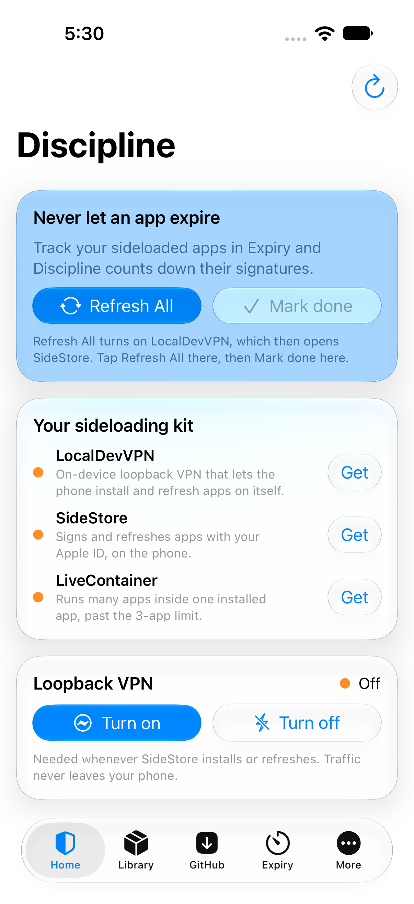
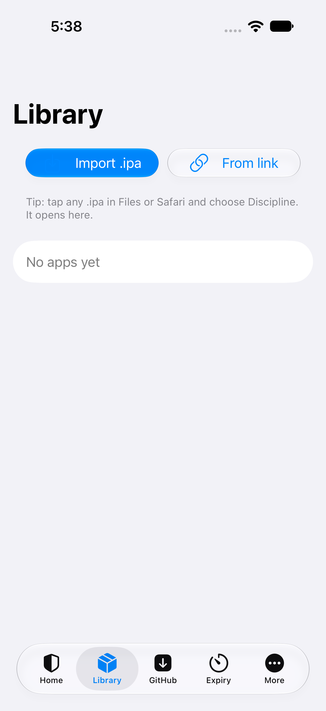
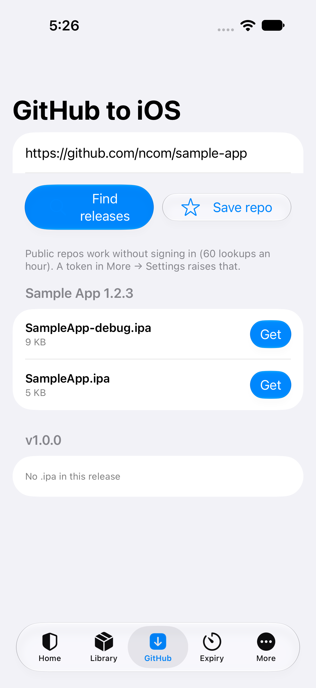
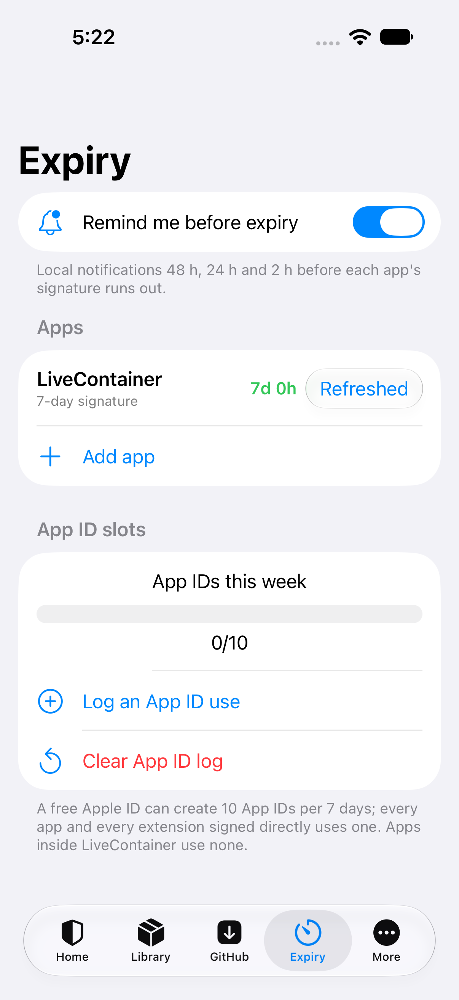
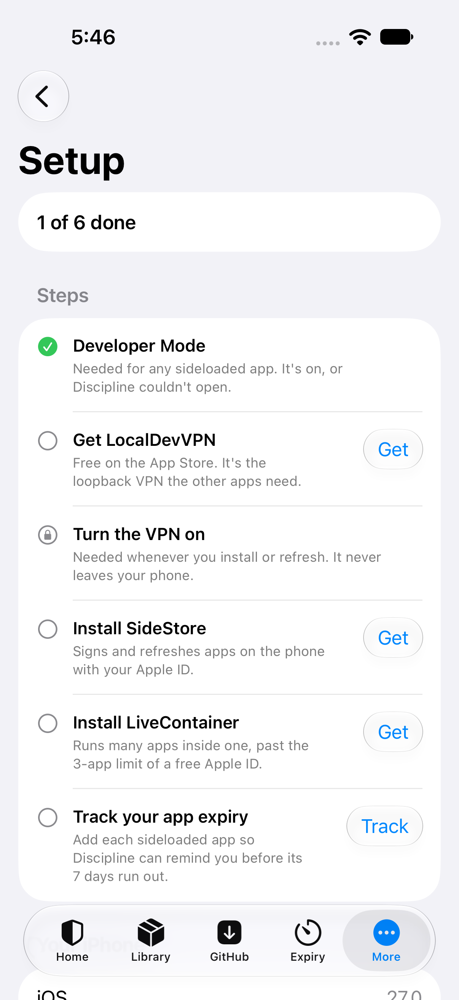
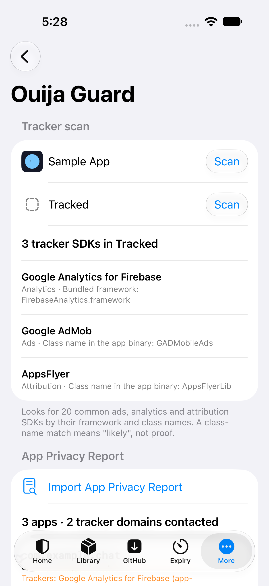
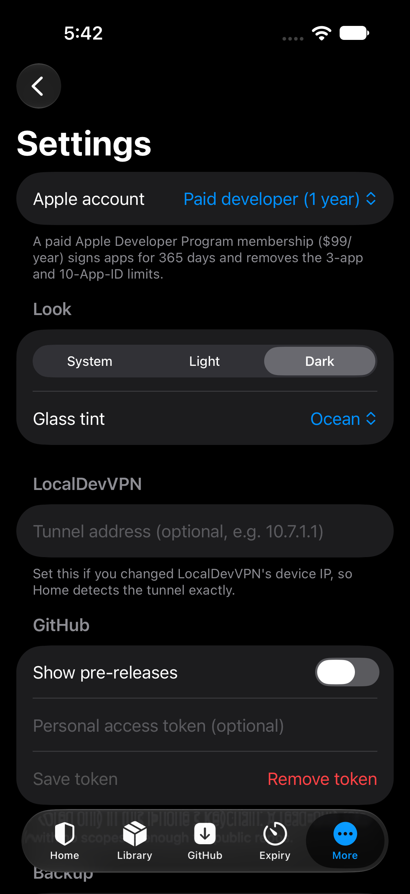
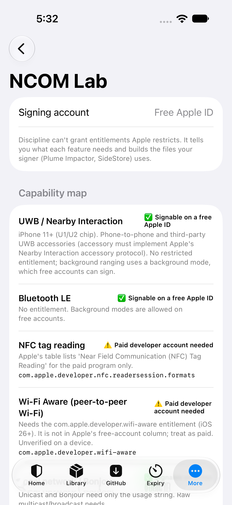

<p align="center"></p>

# Discipline

**One home for your sideloaded apps.** Discipline ties together LocalDevVPN, SideStore and LiveContainer: it opens .ipa files, pulls apps straight from GitHub releases, counts down each app's signature from the date you signed it, and starts a refresh with one tap (LocalDevVPN on, SideStore opened; SideStore does the refreshing). Built by NCOM Systems for iOS 26+ with Liquid Glass.

> **Status (2026-10-22):** compiled and tested on GitHub's Mac runner ([CI run #8](https://github.com/pfn000/discipline-ios/actions/runs/39819722184)): Xcode 27.2 with the iOS 27.2 SDK, 30/30 core logic tests, and 12/12 UI tests on an iPhone 18 Pro **simulator running iOS 27.0**. In this run no UI test needed a retry. The run also built an **unsigned** `Discipline-v0.1.0-unsigned.ipa` (arm64, minimum iOS 26.0). It has **not** been installed or run on a real iPhone yet, and it is not signed: you sign it yourself (see Install).

## Features

| | Feature | What it does |
|---|---|---|
| 🔄 | **Refresh All** | One tap turns on LocalDevVPN, which opens SideStore; you finish with SideStore's own Refresh All. Also available as a Shortcut ("Refresh my apps with Discipline") |
| ⏳ | **Expiry** | Countdown for every app from the signing date you enter, reminders 48 h, 24 h and 2 h before it expires, and a counter for the 10 App IDs per week a free account gets |
| 📦 | **Open in Discipline** | Tap any .ipa in Files or Safari. Discipline shows its name, icon, version, bundle ID and extensions, then hands it to LiveContainer or SideStore |
| 🐙 | **GitHub to iOS** | Paste a repo or release link. Discipline lists the .ipa files, downloads them, hands them off to install, saves the repo, and badges updates when you tap Check for updates |
| 🛡️ | **Ouija Guard** | Scans .ipa files for 20 known tracker SDKs and reads your App Privacy Report |
| 🧪 | **NCOM Lab** *(hidden)* | Entitlements inspector, capability map for the Ouija Board app (UWB, BLE, NFC, Wi-Fi Aware…) and a signing preset builder. To unlock it, long-press the version number in More 7 times |
| 🧭 | **Setup** | A checklist for Developer Mode, LocalDevVPN, SideStore and LiveContainer, with the right link for each step |
| 💜 | **Support** | A tip button that opens NCOM's Stripe donate page |

## Screenshots

Captured by the UI tests in [CI run #8](https://github.com/pfn000/discipline-ios/actions/runs/39819722184) on an iPhone 18 Pro simulator (iOS 27.0). They are real screens of the app, but the tests launch it with test data (a seeded library, a mocked GitHub API and a sample privacy report), so the apps, repos and trackers you see are test fixtures. All 25 are in [docs/screenshots](docs/screenshots/).

|  |  |  |  |
|---|---|---|---|
| Home | Library | GitHub to iOS | Expiry |
|  |  |  |  |
| Setup | Ouija Guard | Settings (dark) | NCOM Lab |

## Install

There is no public download and no GitHub Release. The unsigned IPA exists only as an artifact of the CI run (`discipline-39819722184`, kept until 2026-11-05). Note that artifacts on a public repo can be downloaded by anyone logged in to GitHub. Its SHA-256 is `c7062a1fd25af8becf39cda2d45daa11642507b030d263cd9b1373e007b46a36`.

You sign it yourself with **Plume Impactor** and your Apple ID: see [PLUME-INSTALL.md](PLUME-INSTALL.md). A free Apple ID lasts 7 days and a paid one ($99/yr) lasts a year. Nothing makes it permanent; see [RESEARCH.md §4](RESEARCH.md). It has not yet been tried on a real device.

The build also carries the small fixtures the UI tests use (`Sample.ipa`, `Tracked.ipa`, mock release JSON and a sample privacy report, about 9 KB). The app only reads them when it is launched with the test flags.

## What's not in it (and why)

Anything that can't work in a sideloaded app is left out rather than shown as a dead button:

- **The VPN itself.** A free Apple ID can't sign Network Extensions, so Discipline uses the App Store's LocalDevVPN.
- **Push notifications.** Not allowed on a free account; local reminders are used instead.
- **Screen Time blocking.** Family Controls needs a paid account plus Apple's approval.
- **A Share extension and widgets.** Each needs another App ID out of the 10 per week. "Open in Discipline" covers sharing.
- **"Permanent" signing, enterprise certificates, faking a paid account.** None of these is possible legitimately; see RESEARCH.md.
- **SideStore "refresh now".** SideStore has no such link. Refresh All opens it with the VPN on, and you tap Refresh All there.

## Build it yourself

```sh
brew install xcodegen
xcodegen generate
open Discipline.xcodeproj           # Xcode 27 (iOS 26 SDK or newer)
cd DisciplineCore && swift test     # logic tests (also run on Linux)
```

CI (`.github/workflows/ios.yml`) runs on GitHub's `xcode-27` Mac runner. It runs the core tests and every UI test (a failed UI test is re-run up to 2 more times, and every retry is listed in the run's `retries.txt`), records the simulator, builds `Discipline-vX-unsigned.ipa`, checks it (`Payload/Discipline.app`, Info.plist, arm64) and uploads it as a run artifact. Only a successful `v*` tag build attaches it and its SHA-256 to a GitHub Release, and only while the repo is private, so an unsigned IPA is never published on a public repo.

## Docs

- [RESEARCH.md](RESEARCH.md): sources, free vs paid, iOS 27 notes, jailbreak note, Ouija capability map
- [ARCHITECTURE.md](ARCHITECTURE.md): how the app is put together
- [PLUME-INSTALL.md](PLUME-INSTALL.md): installing it on the iPhone
- [WISHLIST.md](WISHLIST.md): what sideloaders ask for, and what Discipline built
- [LICENSES-AND-CREDITS.md](LICENSES-AND-CREDITS.md)

© NCOM Systems. All rights reserved.
