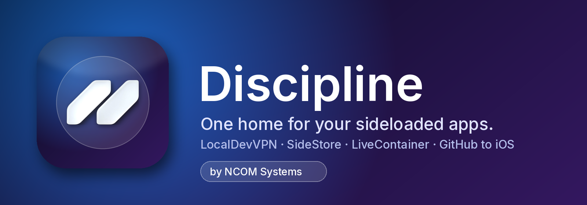

<p align="center"></p>

# Discipline

**One home for your sideloaded apps.** Discipline ties together LocalDevVPN, SideStore and LiveContainer: it opens .ipa files, pulls apps straight from GitHub releases, counts down every signature, and refreshes everything with one tap. Built by NCOM Systems for iOS 26+ with Liquid Glass.

> **Status (2026-10-22):** source complete and the shared logic is tested (30/30 on Linux). The iOS build has **not run yet**: GitHub won't start Actions jobs on this account until billing is fixed (or the repo is made public). So no compiled app, UI-test screenshots or IPA exist yet. They appear here and in Releases after the first green run.

## Features

| | Feature | What it does |
|---|---|---|
| 🔄 | **Refresh All** | Turns on LocalDevVPN, which opens SideStore so it can refresh. Also available as a Shortcut ("Refresh my apps with Discipline") |
| ⏳ | **Expiry** | Countdown for every app, reminders 48 h, 24 h and 2 h before it expires, and a counter for the 10 App IDs per week a free account gets |
| 📦 | **Open in Discipline** | Tap any .ipa in Files or Safari. Discipline shows its name, icon, version, bundle ID and extensions, then hands it to LiveContainer or SideStore |
| 🐙 | **GitHub to iOS** | Paste a repo or release link. Discipline lists the .ipa files, downloads, installs, saves the repo and badges updates |
| 🛡️ | **Ouija Guard** | Scans .ipa files for 20 known tracker SDKs and reads your App Privacy Report |
| 🧪 | **NCOM Lab** *(hidden)* | Entitlements inspector, capability map for the Ouija Board app (UWB, BLE, NFC, Wi-Fi Aware…) and a signing preset builder. To unlock it, long-press the version number in More 7 times |
| 🧭 | **Setup** | A checklist for Developer Mode, LocalDevVPN, SideStore and LiveContainer, with the right link for each step |
| 💜 | **Support** | A tip button that opens NCOM's Stripe donate page |

## Screenshots

The UI tests screenshot every page on an iOS 26+ simulator (`01-home` … `25-lab-preset`). They go in `docs/screenshots/` after the first green CI run. None exist yet, and there are no mock-ups standing in for them.

## Install

The IPA ships unsigned. You sign it yourself with **Plume Impactor** and your Apple ID: see [PLUME-INSTALL.md](PLUME-INSTALL.md). A free Apple ID lasts 7 days and a paid one ($99/yr) lasts a year. Nothing makes it permanent; see [RESEARCH.md §4](RESEARCH.md).

## What's not in it (and why)

Anything that can't work in a sideloaded app is left out rather than shown as a dead button:

- **The VPN itself.** A free Apple ID can't sign Network Extensions, so Discipline uses the App Store's LocalDevVPN.
- **Push notifications.** Not allowed on a free account; local reminders are used instead.
- **Screen Time blocking.** Family Controls needs a paid account plus Apple's approval.
- **A Share extension and widgets.** Each needs another App ID out of the 10 per week. "Open in Discipline" covers sharing.
- **"Permanent" signing, enterprise certificates, faking a paid account.** None of these is possible legitimately; see RESEARCH.md.
- **SideStore "refresh now".** SideStore has no such link. Refresh All opens it with the VPN on, and you tap Refresh All there.

## Build it yourself

```sh
brew install xcodegen
xcodegen generate
open Discipline.xcodeproj           # Xcode 27 (iOS 26 SDK or newer)
cd DisciplineCore && swift test     # logic tests (also run on Linux)
```

CI (`.github/workflows/ios.yml`) runs on GitHub's `xcode-27` Mac runner. It runs the core tests and every UI test, records the simulator, builds `Discipline-vX-unsigned.ipa`, checks it (`Payload/Discipline.app`, Info.plist, arm64), and on a `v*` tag attaches it and its SHA-256 to a GitHub Release.

## Docs

- [RESEARCH.md](RESEARCH.md): sources, free vs paid, iOS 27 notes, jailbreak note, Ouija capability map
- [ARCHITECTURE.md](ARCHITECTURE.md): how the app is put together
- [PLUME-INSTALL.md](PLUME-INSTALL.md): installing it on the iPhone
- [WISHLIST.md](WISHLIST.md): what sideloaders ask for, and what Discipline built
- [LICENSES-AND-CREDITS.md](LICENSES-AND-CREDITS.md)

© NCOM Systems. Private.
